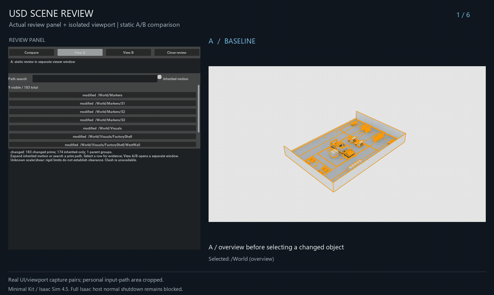

# USD Scene Review

Read-only semantic review of two local OpenUSD scene revisions, with a separate Python engine and NVIDIA Omniverse Kit interface.



Visual demo of the saved scenes before and after movement, with translucent green
geometry marking the previous position under fixed lighting and camera.

**Early development. Windows static review features are tested, but full Isaac app normal shutdown remains blocked by a native failure whose current cause is not isolated.** This integrates existing OpenUSD and NVIDIA APIs; it does not claim a new collision algorithm or the first review/approval workflow.

Follow-up validation: 27 actual Full Isaac feature checks passed before a native
texture teardown warning stopped the run. Full-app use remains unsupported.
The earlier filename-only safety check failed to recognize that Full host; this
local follow-up corrects it using the enabled Full experience. Native confirmation
of the corrected guard is pending. See [current evidence](docs/in-app-sdk-diagnosis.md).

The experimental **in-app A/B split review** candidate renders both revisions, synchronized
cameras and green old-position faces in minimal Kit. Narrow Full Isaac topology
controls now render after first-frame/serialized-binding correction, but full-app
shutdown still crashes and the product split button remains guarded pending full
acceptance. See [installation and exact limits](docs/in-app-review.md).
The GIF above demonstrates the earlier worker route.

## Demonstration

Actual isolated minimal Kit rendering from the installed Windows Isaac Sim 4.5 SDK.
**A is the saved scene before the change; B is the saved scene after the change.
A difference is not automatically a defect.** The camera stays fixed across A/B.

The right-side panel shows comparator-derived selected path, changed properties,
before/after world position, local/world delta, ancestor motion, independent policy,
unknown clash status and separate human review metadata. The rack moves
`(0, 0.2, 0)` to `(0, 0, 0)` m, delta `(0, -0.2, 0)` m. Intentional decisions do not waive rules or unknowns.

In B, **Show old A** adds translucent green geometry at its previous complete world
transform. Current B retains original geometry/materials and orange selected bounds.
Single-sided green surfaces use 22% fractional opacity, with emission/specular
disabled. Subtle half-width Cube/control-cage edges support the visible faces. This uses the installed Kit
OmniPBR template and legacy RTX fractional-cutout support, avoiding glass-like
transmission through many overlapping solids. The prior dense blue style is superseded.
This bounded visual helper supports static visible Cube/Mesh geometry only; it does
not duplicate physics or edit source layers. See [supported limits](docs/support.md#old-a-geometry-overlay).

Preview illumination uses a fixed white dome and manual exposure by default, labelled
NORMALIZED. Source visibility/material differences remain: the reversed demo's B restores
the west wall and changes Steel roughness from 0.42 to 0.32. Their effect is real source
evidence, not a reason to silently restore A's wall/materials. Capture waits for stable
child-rendered frames; [validation](docs/validation.md) records the diagnostic details.

The demo deliberately reverses the actual snapshot roles in private copies: previous
A is on the right, current B on the left. Geometry, manifests, comparison identity and
negative delta agree; no video mirroring or relabelling is used. The GIF shows before A,
current B without the ghost, then current B with the translucent green ghost at old A.
The GIF contains actual native scene and evidence-panel pixels. Private input paths,
source files and logs are excluded. No AI, clash verdict or operational approval is
claimed. Full Isaac host normal shutdown remains blocked; the latest native failure
has not been established as the historical baseline fault.

See [face-only comparisons and close-up evidence](docs/translucent-face-validation.md)
for the actual RTX material check behind this revised appearance.

## Distribution candidate

Rc.3 adds separate scale-normalized effective orientation and point-derived
static Cube/Mesh AABB candidates. Rigid policy rules are unchanged; collision remains
unknown. Candidate scope, exclusions and work budgets are recorded in the report.
See the [supported analysis contract](docs/support.md#static-aabb-candidates).

Build a versioned project-only candidate with `python tools/package_candidate.py <new.zip>`.
Use the [English quick start](docs/quickstart-en.md) or [한국어 빠른 시작](docs/quickstart-ko.md)
for checksum verification, existing-SDK diagnostics, independent synthetic sample,
comparison/export and isolated minimal Kit launch. See [distribution support](docs/distribution-support.md).
No runtime is installed. A project license still awaits the maintainer’s choice; this is
an evaluation candidate, not a formal licensed release.

## Target and checked environments

The Windows target is Isaac Sim 4.5: installed Kit 106.5.0 / Python 3.10.15 / OpenUSD 22.11. CPU/CLI and actual packaged-extension tests use its bundled runtime. Native GUI checks cover static A/B attachment, rendering, selection/framing, repeated switching, close/reopen, negative inputs and source/default-context isolation. Tests use a separate minimal Kit app with synchronous rendering, as configured in the installed Isaac base app; the full Isaac application and production assemblies are not certified. See [Windows validation](docs/validation.md#windows-isaac-sim-45).

The earlier Linux CPU baseline was Kit 107.3.3 / Python 3.11 / OpenUSD 24.05, from an Isaac Sim 5.1 installation with an RC marker. It was not rerun after these Windows changes and is not an upgrade requirement. System Python alone does not provide `pxr`.

## Scope

Fixed local dependency bundles; stable prim paths within the same assembly; explicit time, variant and load configuration; authored versus effective changes; local/world transforms; active and visibility changes; parent movement groups; deterministic JSON and offline HTML reports. Missing evidence produces `unknown`. Input files are never edited. No AI, automatic fixes or general merge.

## Run with an existing OpenUSD Python environment

No package installation is required: set `PYTHONPATH` to this checkout's `src` and use a Python environment that can already import `pxr`.

```bash
export PYTHONPATH="$PWD/src${PYTHONPATH:+:$PYTHONPATH}"
python -m unittest discover -s tests -v
mkdir -p artifacts
python -m usd_scene_review.cli snapshot fixtures/dependency-change/before/scene.usda artifacts/before
python -m usd_scene_review.cli snapshot fixtures/dependency-change/after/scene.usda artifacts/after
python -m usd_scene_review.cli compare artifacts/before/manifest.json artifacts/after/manifest.json --json artifacts/review.json --html artifacts/review.html
```

For an existing Isaac Sim installation whose bundled `pxr` is not on the Python path, use a Python matching its USD ABI with the helper (3.10 for Isaac Sim 4.5; 3.11 for the earlier Kit 107 baseline):

```bash
python tools/with_openusd.py --isaac-root "$ISAACSIM_ROOT" -- -m unittest discover -s tests -v
```

`ISAACSIM_ROOT` is the existing `isaacsim` package directory containing `extscache` and `kit`. The helper never installs packages or launches Kit. For CLI commands, replace the test arguments after `--` with `-m usd_scene_review.cli ...`.

Windows PowerShell, from this checkout, using only an existing 4.5 SDK:

```powershell
$sdk = '<existing Isaac Sim 4.5 SDK directory>'
$python = Join-Path $sdk 'kit/python/python.exe'
# Python 3.10's packaging test needs toml, already bundled in this SDK.
$archive = @(Get-ChildItem (Join-Path $sdk 'extscache/omni.kit.pip_archive-*') -Directory)
if ($archive.Count -ne 1) { throw 'Select the matching installed pip archive explicitly.' }
$env:PYTHONPATH = (Join-Path $archive[0].FullName 'pip_prebundle') + [IO.Path]::PathSeparator + $env:PYTHONPATH
& $python -B tools/with_openusd.py --isaac-root $sdk --timeout 180 -- -m unittest discover -s tests -v
```

The optional `test` extra declares Pillow for capture-image tests and TOML for Python 3.10; both are already available in the qualified SDK. The engine has no added dependency. The helper sets process-local Windows USD DLL directories. It does not change system environment settings. A restricted execution sandbox may prevent asyncio's local socketpair initialization; run tests in a normal local terminal rather than changing security settings. Symlink-specific tests explicitly skip when Windows reports missing privilege.

To repeat the native Windows acceptance in a new private directory:

```powershell
python tools/run_kit_validation.py --isaac-root $sdk --output artifacts/new-kit-run --timeout 360
```

This builds and extracts a project-only ZIP, launches the qualified separate minimal Kit app,
and uses synthetic stages. The optional `--full-app` flag is a diagnostic route whose
normal shutdown is currently unqualified; it is not the distribution quick start. It does not attach to running user apps. Logs and screenshots
stay in the selected output directory; do not publish raw machine logs.

Optional policy flags are `--max-translation` (stage units) and `--max-rotation-degrees`. They apply to changed world rigid poses only, not collision, animation trajectories or application safety. Exit codes: `0` observed equal/changed, `2` unknown comparison/policy or invalid input, `3` observed policy violation. A clash status of unknown is always present; code 0 is never a collision clearance certificate. Destinations must be new paths.

See the generated [JSON example](examples/dependency-change.json) and [offline HTML example](examples/dependency-change.html). Root files are identical in this example; a dependency moves a parent and its child.

## Kit adapter

Add this checkout's `exts` directory to Kit extension search paths and enable `mmporong.scene.review`. See the [adapter guide and pending GUI checks](exts/mmporong.scene.review/docs/README.md). The UI provides searchable rows, inherited-motion filtering and a separate static A/B viewer process; it rejects animated viewport review instead of changing the user's timeline. Semantic reports can evaluate an explicitly configured time.

A self-contained extension ZIP can also be generated from this project's code:

```bash
python tools/package_extension.py artifacts/mmporong.scene.review.zip
```

Extract it into a fresh extension directory and add its parent to Kit's extension search paths. Native extraction/loading and synthetic static A/B review were checked in an isolated Windows Kit process. No NVIDIA binary or third-party asset is included.

See [PR/contribution candidates](docs/contribution-candidates.md), [support](docs/support.md), [plan](docs/plan.md), [prior tools](docs/research.md), [validation](docs/validation.md) and [한국어 안내](docs/ko.md).

## License status

No project license has been selected yet. Do not assume permission to redistribute this project's code until a license is added. This repository contains newly authored code, documentation and synthetic fixtures only. NVIDIA binaries and third-party assets are not bundled. OpenUSD and NVIDIA components retain their own license terms.
