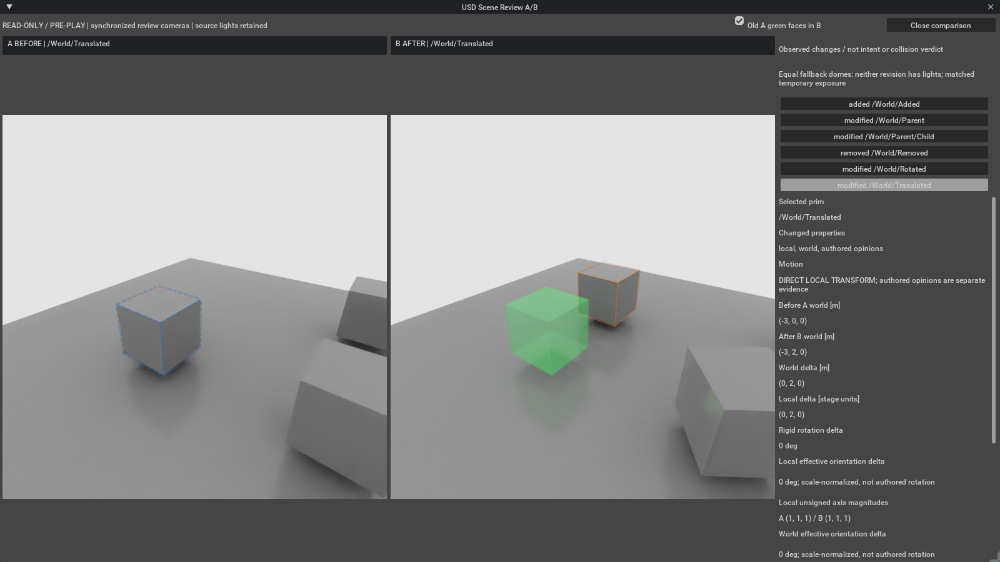

# Local in-app A/B candidate: full Isaac blocked

## Current change-list routes

| Action in the Isaac extension | Actual current route |
| --- | --- |
| Compare frozen snapshots | Shared comparison engine; no named context attachment |
| Click a changed prim | Kit panel before/after values, deltas and direct/parent evidence update |
| Click an AABB pair | Pair evidence and collision-unknown status; no fabricated changed prim |
| Focus an object | Sent only to an already opened owned review viewer; the working viewport is never a target |
| Open same-app live A/B | Experimental named contexts/widgets; Full guard refuses before ownership |
| Legacy single-viewport review | Retained Isaac/Kit child viewer, explicitly a separate process, not same-app completion |
| Main working-viewport stage-free geometry overlay | Not implemented; existing SceneView is a camera manipulator on owned review widgets |
| Close review | Existing owned viewer cleanup; does not close the user's working stage |

Selection routing now retains the latest request while opening, switching or
framing is in flight. Previously numeric evidence changed immediately but the
generic busy scheduler discarded the new frame request, leaving focus on the old
object. Rapid prim/pair clicks now coalesce into one latest follow-up after the
current operation completes. A closed/failed viewer, shutdown or comparison invalidation
discards the request rather than reopening a viewer. Selecting evidence with no
viewer never requests a native focus. No working-stage selection, source camera,
source USD layer or host viewport is an authoring target of this routing change.

Stateful CPU regressions exercise the actual product scheduling/selection methods
with delayed operations. They do not establish actual mouse-click/GPU focus or
unblock Full. No new native or whole-app shutdown experiment accompanies this fix.
The existing Full integration and stage-free overlay gap remain explicit.

Current [review-close/preservation contract and minimal/Full-derived pair](review-preservation.md)
separate window/resource closure from whole-app exit. Named-open controls closed
their owned contexts and preserved working contents/interaction in both hosts, but
changed the working save indicator. They did not create a review window. General
same-app deployment remains unqualified; no guard was removed by these controls.

Follow-up status (2026-10-23): an actual Full Isaac attempt passed 27
functional checks and captured green faces, then failed at the first review close
with a released Hydra-texture-interface warning. A project-free control and the
prior topology run have the same `tf.dll+0xec7b` shutdown access violation. The
product is still unqualified. The former filename-only guard also failed to identify
the actual Full host. The correction recognizes the suffix-free filename and enabled
Full experience. Eight actual Full Isaac guard checks pass: button disabled, both
APIs refuse before native ownership, and stage/selection/time preserved without
bypass. Host shutdown still crashes. See the [current diagnosis](in-app-sdk-diagnosis.md).

This implements two same-process viewports, synchronized owned cameras, a change
list and shared comparator evidence. **It is not qualified in full Isaac Sim 4.5.**
Earlier feature attempts failed with invalid Hydra indices. Subsequently authorized
SDK controls render all three context/viewport topologies after first-frame and
serialized-binding correction, but full-app shutdown still crashes. The prepared
guard now has actual-host refusal evidence; Open A/B remains disabled before native
ownership because full feature lifecycle acceptance is incomplete. See [the diagnosis and new results](in-app-sdk-diagnosis.md).
Compare/export and the legacy worker remain available.



This real capture demonstrates the minimal-Kit route, not full-Isaac integration.

## Install and use

Use the existing Isaac Sim 4.5 / Kit 106.5 SDK; no runtime download is needed.
Add this checkout's `exts` directory to extension search paths and enable
`mmporong.scene.review`. Alternatively run `python tools/package_extension.py <new.zip>`,
extract into a fresh extension directory, and add its parent to search paths.
The ZIP contains project code/docs and the synthetic capture, not SDK binaries.
This local candidate does not replace the preserved rc.3 distribution.

In a minimal-Kit test host:

1. Create independent immutable local A/B snapshot bundles with the README CLI.
   They must not share file layers with the current working stage.
2. Wait for app readiness, keep the timeline stopped, enter manifests and **Compare**.
3. **Open A/B in Isaac** shows saved A left and saved B right in the same app.
4. Select a change in either panel. Both cameras focus the A/B position union with
   identical pose/projection. Added/deleted objects have an explicit absent-side
   label. Values and direct/parent evidence use the shared comparator functions.
5. Navigate either review camera; the other follows. Original scene cameras are
   never synchronization targets. **Old A green faces in B** requests the existing
   0.22 surfaces and thin edges. MDL compilation is asynchronous: early frames can
   show a white fallback. A settled capture and opaque control passed.
6. **Close comparison** / **Close review** requests cleanup and layout restoration.
   Stage changes, window hiding and Play events invalidate review. Exact full-Isaac
   dock restoration and actual Play cleanup have not been qualified.

In full Isaac, use Compare/export or **Legacy worker A/B**. That worker is the earlier
separate-process route; the existing demo GIF does not demonstrate split mode.
The legacy optional focus/normalized-light controls apply to that route. In-app
selection always uses common focus. No physics or robot validation is performed.

## Ownership and comparison conditions

Each snapshot has an owned named USD context/timeline. Anonymous session layers
hold camera, bounds, optional ghost and fallback lights. Source layers are protected
against edit/save while attached; previous permissions/dirty state are restored on
confirmed close. The default stage, source camera, session, selection and timeline
are not navigation targets. Animated snapshots are refused.

Original lights/materials are retained. Equal fallback domes are added only when
neither revision has lights; a real light deletion can darken one revision. Temporary
shared exposure/fractional-cutout settings can affect other viewports while open.
Their baseline is captured before native attachment. Restoration preserves external
edits, handles delayed float32 normalization and SDK resets, and survives retries.

Ghost selection reuses its owned MDL material without reauthoring identical source
or inputs. Normal close clears ghost geometry and waits for 64 rendered frames with
a 10-second bound. The render operation is shielded from caller cancellation.
A failed/cancelled drain retains ownership and blocks reopening until actual native
completion; a confirmed late completion permits cleanup.
Viewports/manipulators are destroyed before stages/contexts. Every handle remains
owned until its destruction succeeds, including across extension reload. Interrupted
attachment is shielded; an uncertain native outcome is never treated as detached.

## Continuation, 2026-10-23

No new GPU tests were run because another Factory/Isaac host was active. A current
project-free shutdown control and finer teardown tracing are prepared. The previous
released-texture warning also occurred during viewport cleanup, so the latest crash
is not established as the historical baseline navigation fault. The full-app guard
remains on; screenshots below and prior functional results are historical.
Final CPU regression: 152 tests, 150 passed, 2 skipped, no failures/errors.

## Actual validation, 2026-10-22

Windows 11 Pro 25H2; Isaac Sim 4.5.0; Kit 106.5; Python 3.10.15; USD 22.11;
RTX 3060 12 GiB; driver 610.62. No SDK/driver/security changes were made.

| Check | Result |
| --- | --- |
| Final serial CPU regression | 148 tests: 146 passed, 2 skipped, no failures |
| Tiny two-context/two-viewport gate, two cycles | Passed, process exit 0 |
| Same gate with synchronous final cleanup | Passed, process exit 0 |
| Single settled ghost + active extension disable | Passed, process exit 0 |
| Translation/rotation/add/remove/parent selection, focus, evidence | Passed in actual minimal Kit |
| Camera synchronization and Kit UI-test row click | Passed; not desktop mouse QA |
| Green surface area and rendered .22 vs opaque control | Passed after warm-up |
| Source camera/session/selection/time, file bytes and render settings | Passed in minimal Kit |
| Repeat close, stage switch, disable/re-enable, active host quit | 36 functional checks passed, process exit 0; native errors still fail qualification |
| Earlier full feature attempt | Invalid HydraEngineIndex 1 before first viewport acceptance |
| Subsequent full SDK topology controls | All three render/cleanup/default-preservation controls pass; host shutdown crashes |
| Exact layout restoration, desktop mouse QA, actual Play | Never run |

Minimal integration `integration-08` passed its 36 functional assertions and exited
0. Its native log still reports MDL snapshot unload failure during active disable,
descriptor allocation failures on re-enable, and live graphics objects at shutdown.
Thus its functional JSON does **not** qualify a clean runtime. The launcher now rejects
these known native error signatures even when functional checks pass and exit is 0.

The first integration had Direct3D `0x887a0006` / `0x887a0005` device loss and an early
white ghost capture. The owned Job was contained after timeout. Later runs did not
repeat device loss, and settled green surfaces/opaque control passed, but the native
material/descriptor lifetime defect remains unresolved.

The first full-Isaac attempt started before initialization completed: command-fence
and engine-index errors, first focus mismatch, then native crash during cleanup.
The second waited for `IApp.is_app_ready()` and still reproduced invalid engine index
1. Fail-fast containment stopped only that Job before more test cycles. A subsequent
authorized topology sequence passed all controls after lifecycle correction, then
stopped again on native shutdown failure. This is separate from the recorded project-free
full-Isaac navigation-plugin shutdown fault; no claim attributes all faults to it.

Intermediate tests exposed renderer baseline capture timing, delayed float32
normalization, a stage-cleanup assertion made too early and a shutdown observer that
ran before product shutdown. Those project/test issues were corrected. A concurrent
CPU run timed out a pre-existing 0.3-second mock wait; the final serial suite passed.
No unrelated Factory Ops process or user scene was manipulated. GPU queries recovered
to roughly 1.7 GiB used and remained responsive; indirect impact on desktop GPU work
was not measured. Raw logs/dumps remain private outside the repository.

## Reproduction and next boundary

With SDK Python/USD paths already configured:

```powershell
python tools/run_in_app_validation.py --isaac-root $sdk --output <new-private-dir> --probe tools/in_app_integration_probe.py --fail-fast-native --timeout 240
```

The default probe without `--probe` is the small lifecycle gate. `--full-app` selects
the installed full app, whose unsafe product route is now guarded. Future full-app
qualification requires a reviewed adapter correction, not a runtime bypass.
Each launch has a fresh portable profile and owned Windows Job and never attaches
to a running app. Containment/timeout is failure. A passed functional result, exit 0
and absence of the known native failure signatures are all required.

Remaining work is full-feature validation of the prepared first-frame/serialized
binding correction, material/descriptor lifetime and full-app shutdown, followed by
fresh native lifecycle/layout/mouse QA. Basic two-context rendering is now demonstrated.
No driver workaround or production-workspace experiment is justified by these results.
