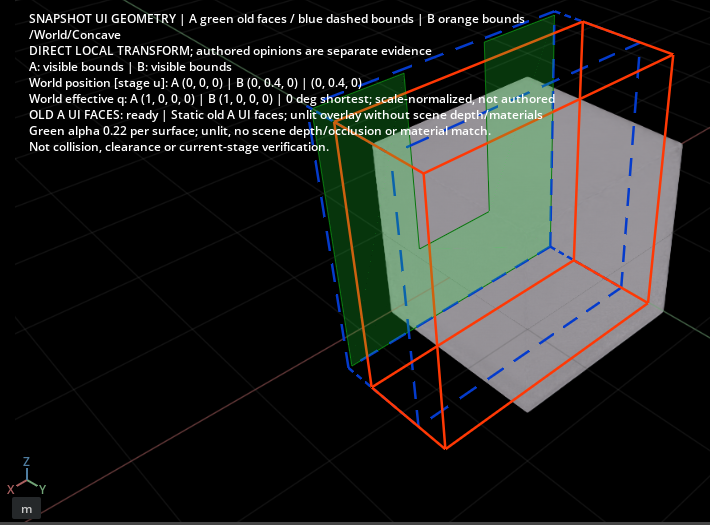

# Static planar polygon faces

The working-viewport old-A face option now accepts simple planar quads and
concave n-gons in a linear (`subdivisionScheme=none`) Mesh. It still creates only
SceneUI geometry, never source/session USD, a named context or an extra viewport.

Exact crop of the owned synthetic native capture; no repaint/resize. The green
U-shaped old polygon retains its notch. Grey working geometry is unchanged.
Use the same [overlay workflow](scene-ui-faces.md). Camera, stage selection and
pending state are preserved; green alpha 0.22 per surface and unlit/depth/material
limitations remain. This does not complete live A/B or a general RTX mesh ghost.

## Geometry contract

Each nonhole face is translated/scaled into a dimensionless local test frame.
A Newell normal establishes a plane; its largest component selects the projection.
The method validates unique vertices, nonzero edges/corners, planarity and every
nonadjacent segment intersection before deterministic ear clipping. Ears must be
convex in the input winding and contain no other polygon vertex, including their
boundary. The final triangles must preserve signed winding and polygon area.
There is **no fan fallback** for an ambiguous or concave face.

Near-coincident/collinear, self-crossing/touching, nonfinite, invalid-index,
degenerate or nonplanar input is refused with an explicit reason. Conservatively
refusing redundant collinear vertices avoids inventing a changed topology.
Normalized orientation/distance epsilon is 1e-10; planarity tolerance is 1e-7 times
the maximum absolute coordinate offset from the first vertex. Area agreement tolerance is 1e-8 relative plus 1e-10 in the
normalized projection. This is a bounded visualization tolerance, not a collision
or precision-metrology claim. Numerical ambiguity clears the whole selected
face overlay; it is not silently accepted as a partially filled Mesh.

USD `holeIndices` omit entire indexed faces, including their wire edges; they are
not arbitrary inner rings passed to the triangulator. A self-touching face that
tries to encode multiple boundary rings is refused. The source polygon perimeter
defines thin wire cues; triangulation diagonals are not drawn. Subdivision,
skinning/deformation, animation, instancing and displacement remain unsupported.

The source orientation token is validated. LeftHanded local ordering and negative
world determinant are encoded in the output triangle winding so its normal direction
matches the opposite-handed USD rule after the complete parent/world transform.
No TRS decomposition or guessed authored rotation is used. The helper remains
unlit; it does not reproduce source normal interpolation or culling.
See [USD winding](https://openusd.org/dev/user_guides/schemas/usdGeom/overview.html)
and [hole face semantics](https://openusd.org/release/api/class_usd_geom_mesh.html).

Existing bounds are 64 geometry prims, 10,000 source points, 20,000 triangles and
20,000 wire segments per selection. Additional limits are 256 vertices per face
and 1,000,000 shared triangulation operations across the selection. The triangle
budget is checked before each face; the operation budget covers pair/cross/ear
tests and fails closed. Independent face vertices retain the prior SceneUI color
fix. Snapshot hashes, manifests, fresh resolver/layer checks and semantic reports
are unchanged; intentional human disposition does not waive any independent rule.

## Regression and qualification

CPU regressions use a concave U with known area 7, both windings and an empty
notch, tilted quads at tiny/normal/large coordinate scales, self-intersection,
nonplanarity, repeated/collinear/invalid/NaN vertices, oversized faces and exhausted
operation budget. Real USD fixtures check hole exclusion, left/right handedness,
negative scale and parent transforms while keeping layer contents unchanged.

Native testing uses only small generated fixtures under the preserved owned
navigation-excluded host and canonical exclusive GPU lease. It distinguishes
actual rendering/callbacks from mouse input. Stock Full shutdown, actual mouse,
large production polygons, long-duration use, scene-depth/material reproduction
and simultaneous live A/B remain unqualified. Full/live A/B guards stay enabled.

The initial full CPU run had one unrelated fake-worker success test fail under
a 0.75s scheduler/disk delay against its 0.3s deadline. Only the positive simulated
protocol deadline was increased to 3s; production timeouts are unchanged and the
explicit timeout-refusal test remains 0.3s. Its 13 focused regressions passed.

The final native run passed 48 candidate and 18 outer checks over two cycles,
including quad, concave/hole omission, explicit nonplanar refusal and reflected
parent winding against inverse-transpose normal direction. Alpha0.22/opaque and
reselection color checks passed; working layers, camera/selection/time/pending,
render settings and file bytes were preserved. Public file.close and natural
exit 0 completed, with owned PID/Job reaped and exclusive lease naturally released.
No forced containment or SDK/driver/global changes were used.

SDK diagnostics remain: 100 errors, 183 warnings, menu/scripting shutdown callbacks
and graphics/Fabric markers. Wrapper exit 2 and **strict-clean=false** are explicit;
this does not qualify stock Full shutdown. The actual mouse backend was not
exposed (`node_repl` required by the installed Computer Use skill), so all UI
interaction here is callback-based. [Sanitized evidence](../diagnostics/polygon-ui-faces-v1.json)
includes final source/code/crop hashes, passed checks, diagnostics and the initial
CPU failure. Raw logs, private paths and assets are excluded.

Final Windows CPU/package regression:228 cases,226 passed and two privilege
skips, no failures/errors (65.154s). Final runtime files match the actual
native-tested copies. The package includes this guide, record and exact crop.
