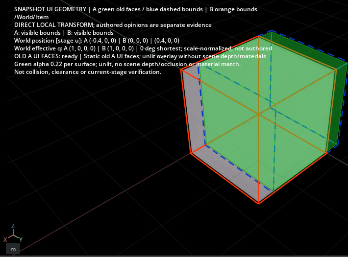

# Old A faces in the working viewport

Optional **Old A green UI faces** adds actual static before-A geometry to the
stage-free overlay: Cube and simple planar polygon linear Mesh, including selected
transform subtrees. These are world-transformed source vertices, not filled AABBs.
See the later [polygon contract and QA](polygon-ui-faces.md) for quad/concave n-gon
support, tolerances, orientation, holes and explicit refusals. Validation below
records the earlier triangle-only implementation.

Authentic owned-host swapchain pixels, cropped to exclude private manifest fields;
no repaint/resize. Working geometry stays grey. A is X=-0.4; B bounds are X=0.

## Workflow and limits

1. [Install the extension](viewport-bounds-overlay.md), use an existing working
   viewport and leave Play stopped. Compare frozen A/B manifests.
2. Choose a change row and click **Show snapshot bounds in working viewport**.
   Enable **Old A green UI faces** beside those controls; enabling can also open
   the overlay. Click other rows to update faces, bounds and shared values together.
3. Clear the checkbox for bounds only. **Clear bounds overlay**, **Close review**,
   hiding the panel, stage change, Play or extension disable clears owned display
   and subscriptions. The checkbox is a preference for the next open.

Deleted items can show A; added items report A absent. Direct/ancestor evidence
comes from comparison; no intent is inferred. Camera and USD selection never move,
so off-screen targets remain off screen. Matching units/up axis do not prove an
arbitrary working stage is B or shares its origin. This displays snapshot world
coordinates, not verification of unsaved edits. USD/session contents and pending
state remain unchanged. The lower legacy **Show old A ... in B** control belongs
to the separate guarded A/B/worker route.

The installed SceneUI 1.11.2 `PolygonMesh` RGBA API was checked in its bundled
Shapes.md and stub, alongside the [official API](https://docs.omniverse.nvidia.com/kit/docs/omni.ui.scene/latest/omni.ui.scene/omni.ui.scene.PolygonMesh.html).
An independent UI camera only reads existing viewport matrices. No USD context,
session prim/material or Hydra viewport is added. Green is (.12,.95,.22), alpha
**0.22 per surface**, with thin perimeter cues. Overlapping surfaces accumulate
opacity. This is unlit UI without RTX depth/occlusion, materials, lighting or
shadows; existing scene appearance/settings are untouched. It does not complete
the general material-aware mesh ghost or simultaneous live A/B review.

Subdivision, unsafe/nonplanar polygons, animation/deformation, instances, displacement
and other Gprims are refused explicitly. Holes omit faces/edges. Per-selection
limits: 64 geometry prims, 10,000 source points, 20,000 triangles, 20,000 wire segments.
Unsupported/budget cases clear faces with a reason; bounds can remain. Numeric
reports, policy, human disposition and collision/clearance-unknown stay unchanged.

## Actual validation

Windows Isaac 4.5/Kit 106.5 used the pinned navigation-excluded Full-derived host,
persistent local exclusions/dry-solve and official exclusive GPU lease. Two cycles
tested actual UI callbacks for Cube, triangle Mesh, deleted item, unsupported
subdivision, toggles/reselection and close. All 39 candidate and 18 outer checks
passed. Working layers/pending/selection/camera/time/settings, source and bundle
bytes were preserved. Public file.close reached natural exit 0; owned PID/Job and
lease cleaned up without containment. These are callback tests, not mouse input.

The first shared-vertex representation had missing/magenta faces despite weak
pixel checks. Independent face vertices fixed the observed rendering; CPU tests
pin that representation. Stronger opaque-green-mask checks found 65,936/69,368
green-dominant pixels at alpha 0.22 (95.05%, threshold 95%), including reselection.
Alpha/opaque mean-sum image difference was 9.184. Boundary/wire/text pixels are not
claimed identical. The corrected capture was also visually inspected; the exact
SDK native cause remains unproven. No SDK file was patched.

SDK diagnostics remain: 8 errors, 604 warnings, tracebacks and graphics/Fabric
markers. Wrapper exit 2 and **strict-clean=false** remain despite native exit 0.
Stock Full shutdown, actual mouse/hit testing, production scenes and long-duration
faces use remain unqualified. The previous 30-cycle sample was bounds-only.
Full/live A/B guards stay enabled. Next work is real mouse workflow QA, broader
Mesh support and an explicit depth/material rendering decision.

[Sanitized evidence](../diagnostics/scene-ui-faces-v1.json) retains both native
runs, code/fixture/capture hashes, metrics and cleanup/diagnostic categories.
An earlier admission attempt launched no Kit: it missed three Microsoft-signed
Windows desktop clients. The correction requires protected OS/package paths and
matching actual process names. Unknown/hidden/spoofed clients, Kit/Python GPU work,
resource limits and shared exclusion remain enforced. Other jobs, SDK/driver and
system settings were preserved; raw logs/private paths/assets are excluded.

Final Windows CPU/package suite:224 cases,222 passed, two privilege skips,
no failures/errors (56.967s). Packaging includes this guide, the sanitized record
and the exact viewport crop. This remains an opt-in static visualization feature.
