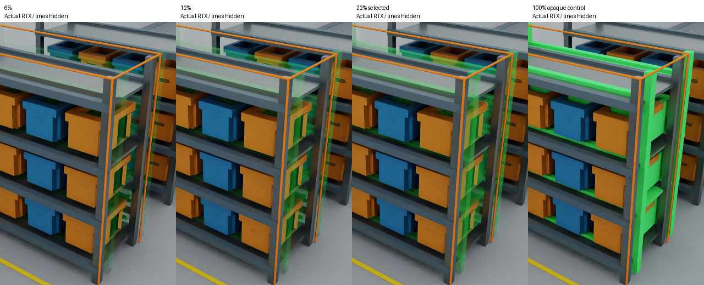
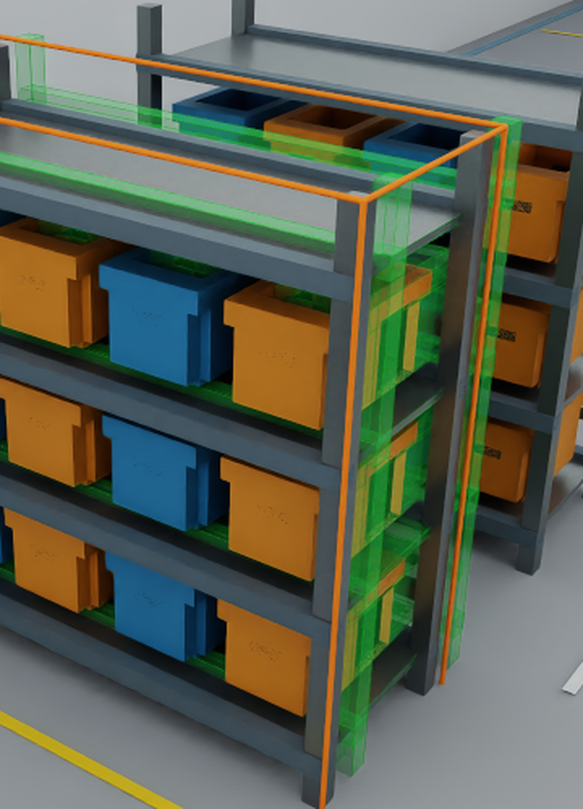

# Visible translucent old-A faces: rc.2 validation

The prior 0.2% helper was almost edge-only. The revised helper uses visible green
faces with recognizable current geometry behind them; control-cage lines are secondary.
Original scene geometry/materials, the white preview illumination, manual exposure,
shared A/B camera and right evidence panel remain unchanged. Old A is right, current
B left, and the comparator still reports world delta (0,-0.2,0)m.

## Material and actual renderer

Selected installed OmniPBR settings are opacity_constant **0.22**, diffuse green
**(0.12,0.95,0.22)**, opacity_threshold **0**, enable_opacity true and
**enable_opacity_texture false**. Emission and specular remain disabled. Faces are
single-sided. Control-cage width is **0.0006** times the old-A geometry diagonal,
half the previous width. Materials and helpers exist only in the owned anonymous
review session; source material networks and physics are never copied or edited.

The actual Isaac Sim 4.5 child resolves the separately installed OmniPBR MDL and
reports RaytracedLighting with `/rtx/raytracing/fractionalCutoutOpacity=true`. Fixed
white dome/manual exposure and identical A/B camera were checked in actual captures.
No NVIDIA template source is redistributed. This is a translucent surface helper,
not physical glass or a volumetric medium.

The mechanism agrees with [NVIDIA OmniPBR opacity parameters](https://docs.omniverse.nvidia.com/materials-and-rendering/latest/templates/parameters/OmniPBR_Opacity.html)
and the [legacy RTX fractional-opacity setting](https://docs.omniverse.nvidia.com/materials-and-rendering/latest/rtx-renderer_rt_legacy.html).
The installed renderer was tested rather than inferring compatibility from current docs.

## Face-only comparison and final media

Actual controls used the same scene, camera, renderer and exposure, with all green
control-cage lines hidden. The 6% and 12% candidates were still weak on shelf faces.
The selected 22% case made shelf/post surfaces and shape clear while the blue/orange
bins behind remained visible. The 100% control obscured that background with dense
green surfaces. This selection was based on actual rendered faces, not brighter edges.

Whole-viewport mean RGB difference from the zero-opacity control was 1.4713 at 6%,
1.6369 at 12%, 1.9135 at 22%, and 3.1057 for the opaque control. These image metrics
are not physical transmission percentages or collision/approval results. The previous
quarter-contrast target is not used to force faces back to invisibility.

The [final actual UI image](../examples/windows45-viewport.png) and
[matching GIF](../examples/usd-scene-review-demo.gif) use the same production-default
captures without diagnostic shader overrides. The GIF holds actual A, B without the
helper, then B with translucent green faces. The close-up crops the same viewport.
Only cropping, enlargement, palette quantization and frame timing were applied; no
scene pixels were generated or mirrored. [Media metadata](../examples/translucent-media.json)
records hashes, settings, native exits, preservation and decoded-frame comparisons.
The GIF is 1560x860, 30 frames, six seconds; SHA-256
`156dd1403e5a4c210f0ec96d61d4511d6be484b0cdbcafb4fcf333a781afe4d6`.

## Completed validation

Qualified environment: Windows 11, Isaac Sim 4.5.0-rc.36 / Kit 106.5.0,
Python 3.10.15 / OpenUSD 22.11 / Pillow 11.2.1, RTX 3060 / driver 610.62.

| Check | Terminal result |
| --- | --- |
| Windows CPU suite | 117 tests, zero failures/errors, two symlink privilege skips |
| Actual face-only material comparison | 26 checks; host/worker exit 0; bundle hashes preserved |
| Production-default media and export | 14 checks; host/worker exit 0; inputs preserved |
| Packaged extension UI regression | 67 checks; host exit 0; four worker exits 0 |
| Exact fresh rc.2 package GPU smoke | 12 checks; host exit 0; both worker exits 0 |
| Post-native package integrity | Original extraction verifies after Kit exit |
| Reproducible packaging | Two byte-identical builds; LF/CRLF normalized |

Native checks cover actual widgets, A/B render settling and camera, original appearance,
Save results, source/default-stage/time/selection preservation, close/reopen,
disable/re-enable and host quit with an active owned viewer. CLI, public-sample and
native JSON evidence match. CPU CI is separate and never certifies NVIDIA rendering;
its exact-commit result is reported with the publication receipt.

Final rc.2 archive: **66,872 bytes**, SHA-256
`6ca6c98f694e1a4cf14c42617b67e3a55e38d5665fe155b1e678bd3de6b9a4b6`.
It contains 32 project payload files plus manifest, with only the independently authored
public USDA pair. No SDK/MDL binaries, private factory originals, raw logs or credentials
are bundled. Kit caches stay in a private manifest-only runtime copy reverified before
launch. The prior distribution baseline remains at commit 219fec5 and its separate rc.1
archive rather than being overwritten by this visual revision.

## Failed or incomplete attempts and limits

The first material comparison failed capture-settling criteria for the opaque control;
it was not a completed acceptance pass. A later execution session became unavailable
before captures/terminal output, with no owned Kit process remaining; its interruption
cause is unconfirmed and does not establish a driver fault. The fresh comparison above
completed with the same settling criterion and bounded retries. Initial wrapper import,
cache-mutation and test-root-binding defects were corrected and revalidated; historical
distribution attempts remain in [the work log](distribution-worklog.md).

The initial combined commit/push was rejected before execution by automatic approval
review while remote authorization was pending. No workaround or retry was made during
that wait. Publication of the exact repository/branch and reviewed code/docs/media was
subsequently authorized. No merge, ready transition, formal release, vendor submission
or license selection is part of this candidate.

The project license remains **undecided**; MIT was not applied. Full Isaac application
shutdown has a previously reproduced baseline SDK fault and was not rerun or repaired.
Human interactive acceptance, manual early GPU-startup close, other SDK/GPU combinations
and production assemblies remain unqualified. Animated viewport and unsupported geometry
are refused; no clash verdict, AI or operational approval is claimed. No runtime/driver
installation, reboot, security setting change or unrelated live-scene edit was performed.
