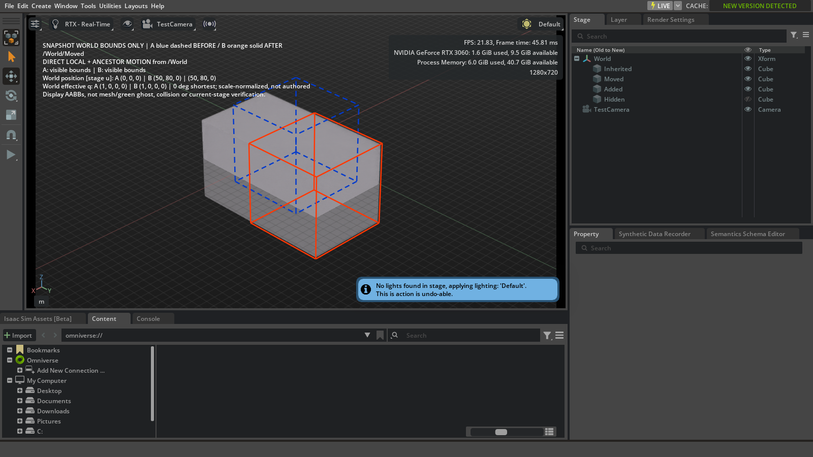

# Snapshot bounds in the working Isaac viewport

The **Show snapshot bounds in working viewport** action draws selected revision
bounds inside the existing default Isaac viewport. It creates an `omni.ui.scene`
overlay, not USD prims, another USD context, a renderer texture or another viewport.
This narrow path is separate from the still-guarded live A/B review.



These are always-on-top world-axis-aligned bounding boxes: blue dashed **A before**
and orange solid **B after**. They are not meshes, the requested translucent green
old-position faces, an occlusion-correct hologram or collision evidence. Existing
working geometry and materials remain visible. The text uses the same comparator
values and direct/ancestor interpretation as the evidence panel; it does not infer
why a person edited the scene.

## Install and use

Use the existing Isaac Sim 4.5 installation. Add the checkout's `exts` directory to
extension search paths and enable `mmporong.scene.review`. Alternatively run
`python tools/package_extension.py <new.zip>`, extract into a fresh directory, and
add its parent to search paths. The project-only ZIP includes this guide and the
synthetic capture; no SDK or production scene is bundled.

1. Prepare independent frozen A/B snapshot bundles and keep Play stopped.
2. Enter their manifests in **USD Scene Review** and choose **Compare**.
3. Choose **Show snapshot bounds in working viewport**. This also works before a
   change has been selected: the overlay explains that selection is required.
4. Click a changed-prim row. Bounds and before/after position/orientation values
   update. Enable **Inherited motion** to expose inherited-only rows. A deleted
   prim needs no counterpart in the working stage: its A-only bounds remain useful.
5. Navigate the existing camera yourself if the saved coordinates are off screen.
   The action never frames objects or changes native prim selection. A pair row
   clears single-prim bounds and keeps its pair evidence in the panel.
6. **Clear bounds overlay**, **Close review**, hiding the review panel, hiding the
   viewport, stage opening/closing or disabling the extension clears the overlay.
   The timeline guard also clears it when the timeline stops being stopped; this
   branch has CPU coverage, not a new actual Play/simulation test.

The existing viewport must use the default USD context. Its meters-per-unit and
up-axis must match valid, matching A/B metadata. No alignment or conversion is
guessed. These are saved snapshot coordinates; the tool does not assert that the
currently edited stage is identical to B. Invalid/stale inputs or an invalid report
selection refuse/clear display. Hidden, inactive, absent and unbounded sides have
explicit labels; no missing side is invented. Display bounds can aggregate a
selected subtree and are not reused as point-derived overlap-analysis evidence.

## Ownership and installed API basis

Installed `omni.kit.viewport.window` 107.0.8 provides `ViewportWindow.get_frame(name)`.
One fixed frame key is reused. `omni.ui.scene` 1.11.2 provides `SceneView`, its own
`CameraModel`, `Matrix44` and `Line`. Existing viewport API 107.0.7 exposes read-only
view/projection copies. Updates copy those matrices only into the independent UI
camera model. The overlay does not call `add_scene_view`, assign the viewport's
shared camera model, attach/open a stage, author a session layer or set save flags.
No global renderer/lighting/exposure setting is changed.

The two owned subscriptions observe app updates and working-stage lifetime. Close
unsubscribes both, clears the scene, destroys the SceneView and drops snapshot,
camera, context and viewport references. The SDK caches one empty named UI frame;
it is hidden/cleared and reused, not accumulated on reopen. No owned hidden viewport
or renderer texture is retained. This is an actual resource distinction from the
earlier named-context/texture candidates, not a claim that hiding resources fixed
their teardown failures.

## Validation boundary, Windows Isaac 4.5

The native acceptance used the installed **Full app**, with navigation retained,
Kit 106.5, Python 3.10.15, USD 22.11, and a fresh extracted project ZIP. The canonical
shared GPU wrapper acquired its normal exclusive OS lock, checked other work and
admitted only the owned test host. Only disposable synthetic files/stages were used.
Fixture camera creation and native selection setup happened before preservation
baselines; the product never performs either operation.

Actual checks cover A/B lines and values, no selected comparison prim, deletion
without a working prim, addition/hidden side, parent propagation, invalid selection,
reselection, two reopen cycles, removal of native update subscriptions, hidden
viewport, owned stage transition, real extension change-handler routing, pair-row
clearing, Close review, panel hiding and extension disable. Source/frozen file
hashes, working root/session text and dirty flags, edit target, on-disk working
file, native selection, camera/view/projection, timeline and selected settings are
compared. Native pending stays **false to false**. Pre-existing native selection is
also preserved through the extension route. The Full live A/B guard remains active.

The final native run passed **40/40** checks, with **0 console error lines and 110
warning lines** before intentional host containment. Working native pending was
false both before and after. Pixel counts in the fixed viewport region changed
from zero to 2,215 blue and 4,956 orange pixels. The preceding visible-bounds run
also passed 39 checks before the final caption/invalid-selection/selection-state
acceptance was added. These counts describe these synthetic runs, not broad
production qualification.

The visible synthetic capture is checked against an overlay-free capture for blue
and orange pixels; object counts alone were not accepted as rendering evidence.
Earlier local probe setup errors and an initial invisible-bounds capture were
failures, not UI passes. Full asynchronous startup must finish before recording
the working-stage baseline: app readiness precedes its initial stage/layout setup.

The test invokes actual UI handlers and uses native rendering; it is not manual
mouse-hit or navigation-input QA. Normal whole-app exit is **not tested here**.
After functional receipts the owned host is deliberately contained with its Job
(native exit1), all owned PIDs are reaped and the wrapper naturally releases the
lease. This is not a graceful-exit result or a fix for the existing Full shutdown
crash. Warning counts remain recorded separately; they do not disappear because
the bounds feature passes. Production-assembly performance, arbitrary layouts and
other SDK versions remain unqualified.

CPU regression uses the documented bundled-USD environment and
`python -m unittest discover -s tests -v`. The Windows suite contains 198 cases;
196 pass and two privilege-dependent cases are skipped. It covers stale input,
units mismatch, invalid selection, ancestor/deletion bounds, cleanup and camera
copy direction. CPU mocks alone did not establish the native rendering result.

## Reduced-profile exit follow-up: failed before public close

A single later treatment reused the pinned crash-free **navigation-excluded**
baseline, its unchanged `shutdown-clean.usda` hash, canonical shared lease, SDK
and public file-close/normal-quit route. A/B bundles were authored by the CPU
launcher before Kit started; the working fixture was not edited. No mouse-control
tool was available. Actual Compare scheduling and change/select/show/clear/Close
button callbacks were exercised twice in the installed Full-derived host.

18 treatment checks passed, including both selection/toggle/close cycles, removed
subscriptions, preserved working state and extension disable. Pending was false
before and after. However, logs show navigation core/recast starting immediately
after dynamic review-extension activation, despite their startup exclusion. Thus
the reduced baseline configuration was no longer preserved. The diagnostic also
tried to read the unloaded extension's `_bounds_overlay`: installed Kit clears an
extension instance's `__dict__` after `on_shutdown`, causing an AttributeError.
This is an observation-code defect, not evidence of a viewport teardown crash.

Public file.close and app quit were **not invoked**. The controller contained its
owned Job (exit1); the fixture hash was preserved, all owned PIDs were reaped, the
Job was empty/closed, and the wrapper naturally released its lock. There were zero
console error lines and 110 warning lines before containment. Post-treatment frozen
input-hash completion was not reached. No normal-exit or crash-free-overlay shutdown
claim follows from this failed attempt; the original reduced baseline's exit0
observation and earlier Full overlay's 40 functional passes remain distinct.

The diagnostic now refuses immediately if activation re-enables either excluded
navigation extension or loses schema. Its unload receipt samples owned resources
before disable and never reads the scrubbed instance afterward. CPU regressions
cover both defects, incomplete receipts, changed pending, warnings and nonzero
exit. These follow-up changes have **not** been rerun on the GPU; the same failed
conditions are not repeated.

Final Windows CPU/package regression after those diagnostic fixes: 202 cases,
200 passed, two privilege skips, no failures/errors (46.979s). This does not add a
native shutdown pass.

Reproduction is explicit and restricted to the owned reduced profile:

```powershell
tools/run_shutdown_profile.ps1 -IsaacRoot <existing-sdk> -Output <new-evidence-dir> -DiagnosticProfile no-navigation -Candidate viewport-bounds
```

This is a fail-closed diagnostic, not a recommended user-app configuration. Before
another exit treatment, a supported activation path must preserve the exclusions
(for example a separately reviewed startup-loaded treatment); manually turning
navigation off again would conceal the configuration drift. No SDK or user settings
were changed here.

Remaining qualification priorities:

1. Preserve and verify the reduced host configuration through extension activation,
   then obtain an actual file.close/normal-exit result in a distinct treatment.
2. Check real mouse hit/navigation behavior and representative assembly performance;
   current evidence is native rendering plus UI callbacks on synthetic fixtures.
3. Keep live A/B named-context/texture lifecycle and green mesh faces as separate
   unresolved work. Their Full guard stays enabled; bounds do not replace them.
